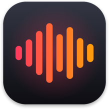

#  ‎ ‎ ‎dictate

[](https://www.apple.com/macos/)
[](https://swift.org)
[](LICENSE)

**dictate** is push-to-talk dictation for macOS. Hold Right ⌘, talk, and let go. Your speech is transcribed on-device with Parakeet, cleaned up by Claude Haiku, and pasted wherever your cursor is.

## Install

```
./build.sh
```

Allow Accessibility and Microphone access when asked. For cleanup, add an Anthropic API key:

```
security add-generic-password -U -s com.ravibandaru.dictate -a anthropic-api-key -T /Applications/Dictate.app -w
```

Without a key or internet, Apple's on-device model does the cleanup instead.

## Shortcuts

| Key | Action |
|-----|--------|
| Hold `Right ⌘` | Dictate, release to paste |
| Double-tap `Right ⌘` | Hands-free, tap again to finish |
| `Shift` | Paste the raw transcript |
| `Esc` | Cancel |

## Contact

- Ravi Bandaru: ravi.bandaru@northwestern.edu

## License

MIT. See the included `LICENSE` file.
